# StudEase

Tuition and fees, scholarship eligibility and payments, and student-balance reconciliation, with a synthetic data
generator, five labelled anomalies, a validator, detectors and a working three-tier application.

- **What it does:** bills each student from versioned fee schedules, decides scholarships by published rules, allocates
  payments to the oldest due line first, handles withdrawals and refunds, and proves every balance three ways
  (stated balance = sum of the append-only ledger = invoices - payments + refunds).
- **Data:** 10,000 students, 20 programs, 30,000 invoices, 15,000 awards, 50,000 payments from fixed seed
  `20261022`; the same generator runs at a small "starter" scale. All people are synthetic (`@example.edu`).
- **App:** `frontend/` (React + TypeScript), `backend/` (FastAPI), `database/` (PostgreSQL schema and migrations).
  Three tiers in three folders; the business rules live in a pure `backend/app/domain/` package with no framework in it.

**Live demo:** https://studease.is-cool.dev. Sign in as `learner@`, `instructor@`, `academic@`, `support@` or `admin@example.edu` with the
demo-only password `Studease-Demo-2026`, or create your own learner account from the sign-in page. The demo accepts writes (payments, enrolments,
withdrawals, resolutions) by design; all data is synthetic.

Start with [docs/walkthrough.md](docs/walkthrough.md) (one student followed end to end) or
[docs/architecture.md](docs/architecture.md) (every rule, with its id).

## Screens

| | |
|---|---|
| 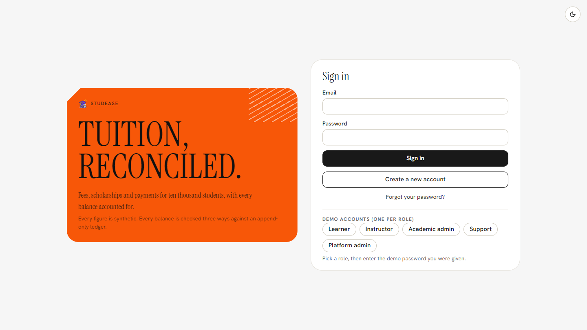 |  |
| Sign in, with a visible **Create a new account** button | Learner account: balance cards, money by kind, balance over time, pay now |
| 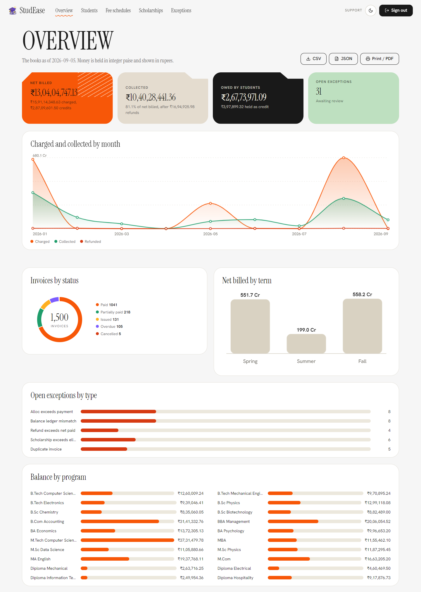 | 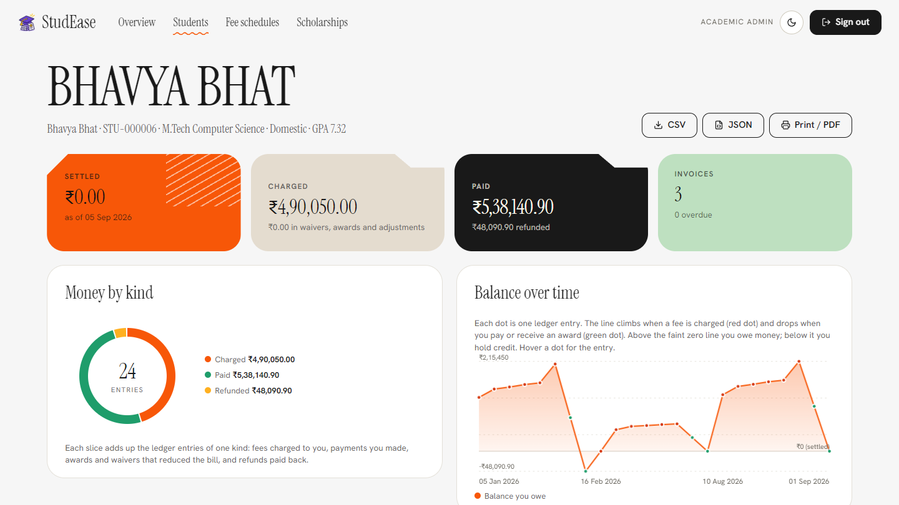 |
| Overview for staff: monthly line chart, status donut, term bars | Student page for an academic admin: edit details, assign scholarship, invoice downloads |
| 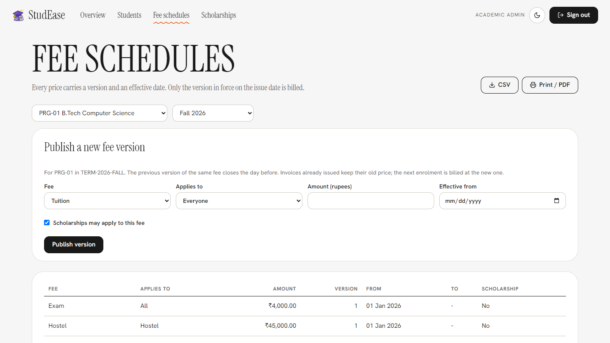 | 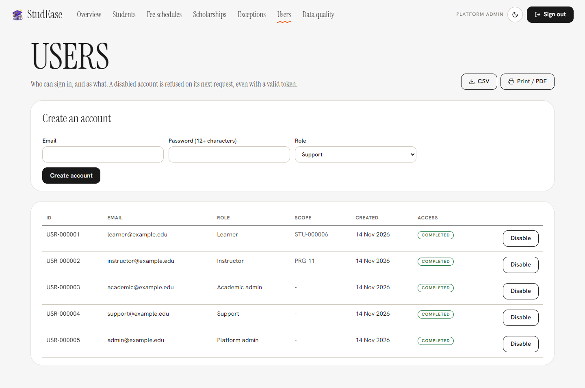 |
| Fee schedules with **Publish a new fee version** | Platform admin: create and disable accounts |
| 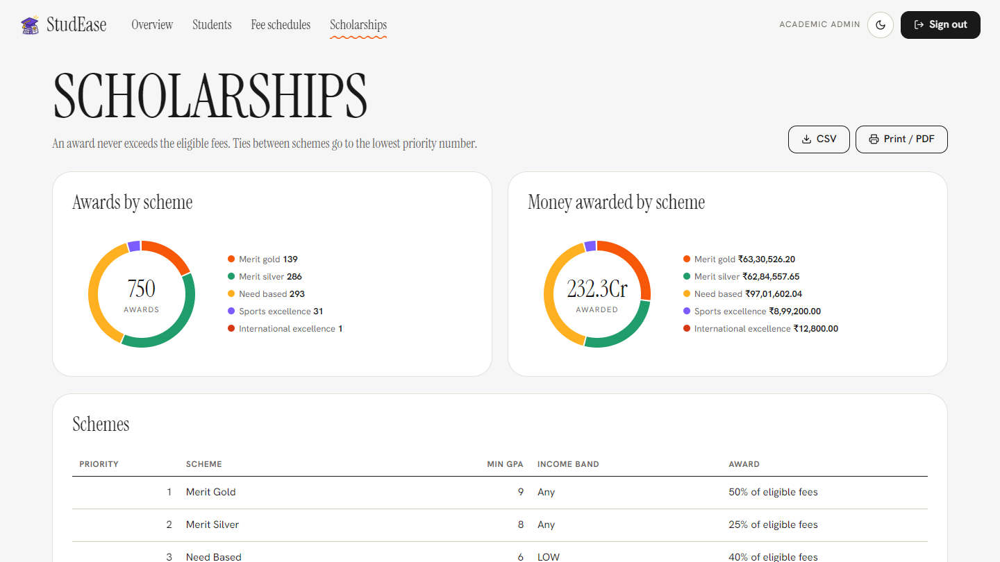 | 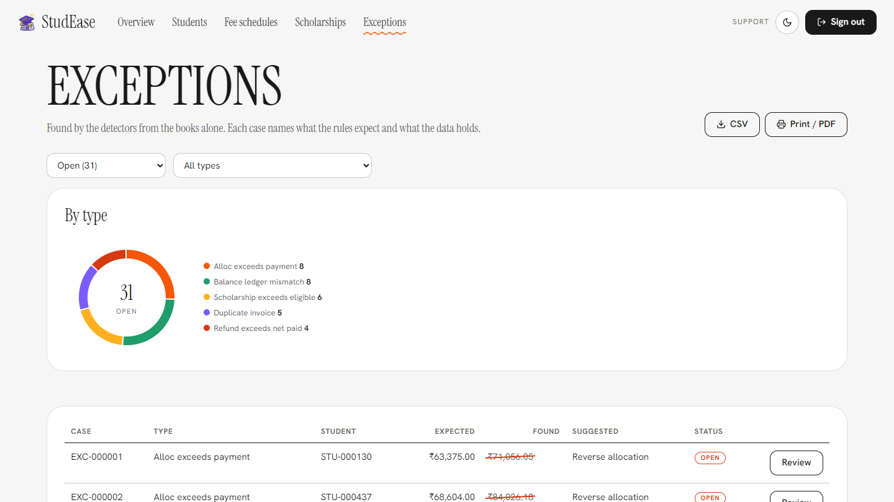 |
| Awards by scheme (count and money) | Exception queue with a by-type donut |
| 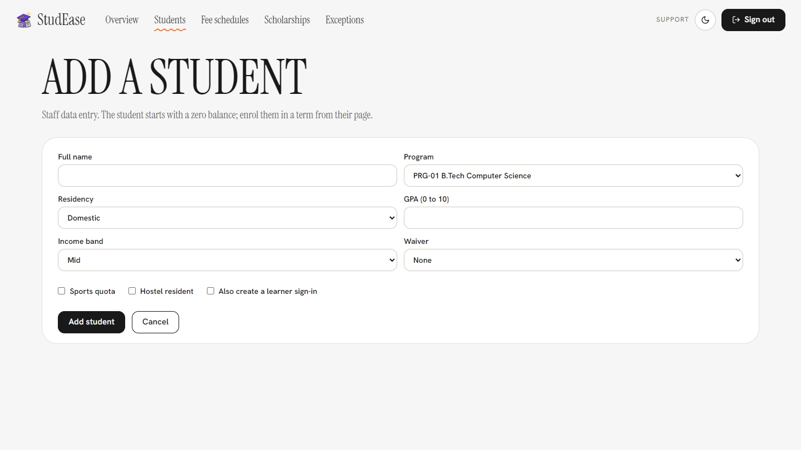 | 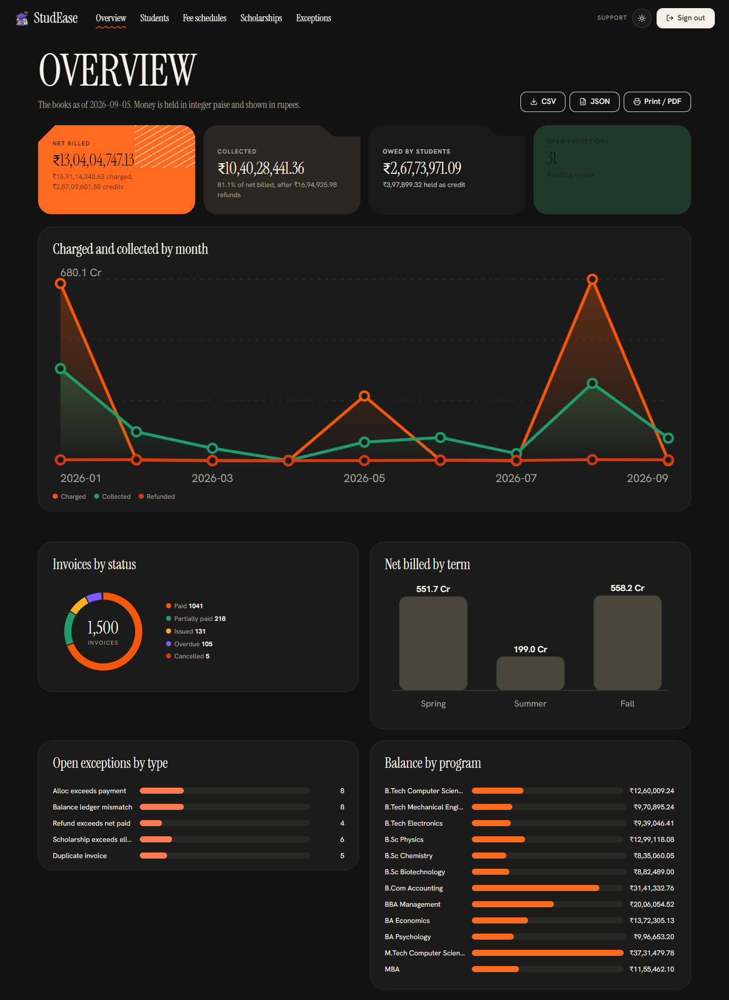 |
| Staff data entry | Dark theme |

Also in `docs/screenshots/`: `learner-enroll.png`, `students.png`, `data-quality.png`. All are 1440 by 810 desktop captures.

## Quick start

**Windows, one step:** run [`run.bat`](run.bat). It checks the tools, installs, starts the database, loads the data and opens the app
(details and troubleshooting in [SETUP.md](SETUP.md)). Or follow the manual steps below.

### Prerequisites and setup flow

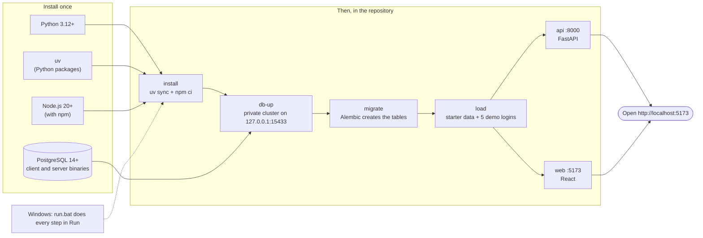

No Docker and no accounts are needed. The database is a throwaway cluster inside the project (`.pgdata/`), so an existing PostgreSQL is never touched.

The same steps as commands:

```bash
python scripts/dev.py install      # backend and frontend dependencies
python scripts/dev.py db-up        # local PostgreSQL on 127.0.0.1:15433 (created on first use)
python scripts/dev.py migrate      # schema, from database/migrations
cp backend/.env.example backend/.env   # then set DEMO_PASSWORD (any value; it is the demo login password)
python scripts/dev.py load         # loads the starter data and seeds one demo login per role
python scripts/dev.py api          # API on http://127.0.0.1:8000  (docs at /api/v1/docs)
python scripts/dev.py web          # app on http://localhost:5173  (second terminal)
```

`make <command>` does the same where `make` exists; `python scripts/dev.py help` lists every command. Windows,
macOS and Linux are all supported (the runner is standard-library Python).

Sign in at `http://localhost:5173` with `learner@`, `instructor@`, `academic@`, `support@` or `admin@example.edu`
and the `DEMO_PASSWORD` you set, or use **Create a learner account** on the sign-in page. Each role sees and can do different
things ([architecture §3](docs/architecture.md), [docs/frontend.md](docs/frontend.md)).

To load the full 10,000-student dataset instead: `SCALE=full python scripts/dev.py load` (about 30 seconds).

### Configuration (`.env`)

Settings come from environment variables, read from `backend/.env` (git-ignored; `backend/.env.example` lists every
variable with no values). Nothing secret is ever committed. In production (`ENV=prod`) the API refuses to start
with a default or short `JWT_SECRET` or `DEMO_PASSWORD`. Mail is optional: set the `SMTP_*` variables to enable
password-reset links and payment receipts; `MAIL_TEST_TO` redirects mail meant for synthetic users to one test inbox.

## Tests

```bash
python scripts/dev.py test            # backend: 230+ tests (domain rules, data, API, security, loader)
cd frontend && npm test               # frontend unit tests
python scripts/dev.py lint            # ruff
cd frontend && npx tsc -b             # TypeScript
python scripts/scrub_check.py         # the public-repo hygiene check
```

The database tests need the local cluster from `db-up` and skip themselves, with a message, when it is not running.
How the tests are organised, and what each proves: [docs/testing.md](docs/testing.md).

## Verify the data

```bash
python scripts/dev.py data         # generate (SCALE=starter|full), write CSV/JSON/SQL and the manifest
python scripts/dev.py validate     # nine checks, every violation classified: explained by a label or unexpected
python scripts/dev.py repro        # generate twice, compare row counts and SHA-256 checksums
python scripts/dev.py reconcile    # run the detectors (they never see the ground truth) and score them
```

| | Starter | Full |
|---|---|---|
| Rows generated | 50,339 | 1,004,038 |
| Students / invoices / awards / payments | 500 / 1,500 / 750 / 2,500 | 10,000 / 30,000 / 15,000 / 50,000 |
| Labelled anomaly cases | 31 | 600 |
| Validation | passed, 0 unexpected violations | passed, 0 unexpected violations |
| Two runs identical | yes (all tables) | yes (all tables, matches the committed manifest) |
| Detector precision / recall | 1.0 / 1.0 | 1.0 / 1.0 |
| Collection rate / late-fee incidence / reconciliation rate | 0.790 / 0.294 / 0.984 | 0.792 / 0.281 / 0.985 |

Reports are committed in `reports/<scale>/`; data is in `data/<scale>/` (the full set as compressed CSV with a
manifest). The data dictionary and entity diagram are generated from the schema: [docs/data_dictionary.md](docs/data_dictionary.md),
[docs/erd.md](docs/erd.md).

### The five labelled anomalies

| Anomaly | What is wrong | How it is caught |
|---|---|---|
| `ALLOC_EXCEEDS_PAYMENT` | allocations add up to more than the payment | per-payment sum of allocations vs amount |
| `SCHOLARSHIP_EXCEEDS_ELIGIBLE` | award larger than the scholarship-eligible fees | award vs recomputed eligible fees (R-SCH-1) |
| `DUPLICATE_INVOICE` | one enrollment billed twice | more than one live invoice for an enrollment |
| `REFUND_EXCEEDS_NET_PAID` | refund larger than payments minus earlier refunds | running net paid at the approval date (R-REF-2) |
| `BALANCE_LEDGER_MISMATCH` | stated balance differs from the ledger | the three-way balance identity (R-LED-3) |

Ground truth is stored separately (`data/*/ground_truth/`, and the `gt` schema in the database) and is never a column of
an input table; a test fails if a leak word appears in any input table.

## What makes it more than a prototype

- **Integer money:** paise and basis points everywhere, round half up, one rule for every percentage. No floats near money.
- **Append-only history:** the ledger and the event table are only ever added to; reversals are negative rows.
- **Database as a second line of defence:** primary and foreign keys, `CHECK` constraints for every enumeration and
  sign rule; the backend cannot write a forbidden row even if it has a bug.
- **A complete learner journey:** create an account, enrol in a term (fee preview, scholarship checklist with the reason for every scheme
  you do not meet), pay, withdraw, see awards and fees, export a statement, change your password. Staff can enrol a student through the same code.
- **Export everywhere:** CSV (spreadsheet-safe: UTF-8 BOM, formula neutralisation), JSON and Print / PDF on every list and account; lists export
  the whole filtered set, not the visible page.
- **A designed interface, not a template:** cut-corner and folder-tab cards, wavy navigation, pill buttons, scroll and pointer
  motion, charts that draw in, skeleton cards with the real shapes while data loads, a top progress bar, a splash, toasts, light and dark themes
  ([docs/frontend.md](docs/frontend.md)).
- **Safe writes:** a payment is idempotent (`Idempotency-Key`, scoped to the caller), takes a row lock on the student and
  an advisory lock for id numbering, and writes the payment, allocations, ledger, events and balance in one transaction.
- **Security:** scrypt passwords, pinned-algorithm JWTs, role checks in one place, object-level scoping, bound
  parameters only (a test fails if SQL is built from strings), strict input models, error envelope with request ids,
  CORS allow-list, security headers, hardened service unit. The full list (S-1 to S-23) is in [architecture §12](docs/architecture.md).
- **A real error experience:** the app has its own 404, 403 and crash pages (route error boundary); the API always
  answers with a JSON error envelope and an `X-Request-ID`; nginx serves a static page ([frontend/public/50x.html](frontend/public/50x.html))
  when the API is down; an expired session returns you to sign-in.
- **Polish:** per-page titles and meta descriptions, Open Graph tags, a hand-drawn favicon and app icons, a web manifest, `robots.txt`,
  light and dark themes, keyboard focus styles and a skip link, reduced-motion support, mobile layout (360 px and up).
- **Deployment as code:** [deploy/](deploy) holds the nginx config, the systemd unit and a script with health check and
  one-command rollback; CI runs lint, tests, the docs-freshness check, the reproducibility check and the hygiene scan.
  How it is deployed, step by step: [docs/deploy.md](docs/deploy.md).

## Engineering extras (the long list)

Beyond the required features, these are implemented and tested or checkable in the repo. Each line is one thing a reviewer can ask about.

**Performance and loading**

1. Route-level code splitting: every page is a `React.lazy` chunk, fetched on first visit (`frontend/src/App.tsx`), with a skeleton fallback.
2. Vendor chunks (`react`, `query`) split out so they cache across releases.
3. Hashed assets served `Cache-Control: public, immutable`; gzip on for text, JS, JSON and SVG.
4. Keyset (cursor) pagination on every list: stable under concurrent writes, constant cost at any depth, no gaps or repeats (tested).
5. "Load more" paging in the UI; exports follow the cursor to fetch the whole filtered set on demand.
6. Search debounced (250 ms) so typing does not fire a request per key.
7. TanStack Query cache (30 s) with exact invalidation after writes; no retry on 4xx, two retries on 5xx.
8. A test proves list endpoints run a constant number of SQL queries (no N+1).
9. Reveal animations use `transform` only (no layout thrash); `prefers-reduced-motion` switches animation off.
10. Charts are inline SVG, no chart library; fonts self-hosted and subset; the only image is a small async-decoded logo.

**Loading and error experience**

11. Skeleton cards that carry the real shapes and labels of the cards that replace them.
12. A top progress bar while any request runs (appears after 120 ms so quick requests do not flicker).
13. Splash screen on first load; spinner on every button that submits; toasts for results.
14. Custom 404, 403 and crash pages; route error boundary; an expired session returns you to sign-in.
15. A static `50x.html` from nginx when the API is down.
16. Every API error is one JSON envelope with a request id, and no stack trace ever reaches a client.

**Data integrity and money**

17. Integer paise and basis points everywhere; one rounding rule (half up).
18. Append-only ledger and event history; mistakes are corrected by new rows, never edits.
19. Three-way balance reconciliation (stated, ledger, invoices minus payments plus refunds) shown on screen with a strike through any figure that disagrees.
20. Database `CHECK`, primary and foreign key constraints as a second line of defence behind the application rules.
21. Idempotency keys (scoped to the caller, bound to the body hash): a retried payment never double-posts.
22. Row lock per student plus an advisory lock for id numbering; a concurrency test proves no double allocation.
23. One transaction per write: payment, allocations, ledger, events and balance commit together or not at all.
24. Deterministic synthetic data (one seed, byte-identical output) with a reproducibility check.
25. Detectors compared with hidden ground truth in an evaluation report, with the honest limits stated.
26. Versioned fee schedules; a new price is billed only to later enrolments.

**Security**

27. scrypt password hashing; pinned-algorithm JWTs; role and enabled flag re-read from the database on every request.
28. Role guards in one place plus object-level scoping (out-of-scope ids answer 404, so ids cannot be probed).
29. Bound SQL parameters only; a test fails if any SQL is built from strings.
30. Strict request models (`extra="forbid"`, patterns, ranges, lengths) and a control-character guard.
31. Login answers identically for unknown email and wrong password; forgot-password always answers 202; reset links are one-time.
32. CORS allow-list; HSTS, CSP, X-Frame-Options, Referrer-Policy, Permissions-Policy headers; production refuses to start with default secrets.
33. CSV exports neutralise spreadsheet formulas (`=`, `+`, `-`, `@`).
34. Secret and personal-data scrub check (`scripts/scrub_check.py`) runs in tests and CI.

**Accessibility and polish**

35. Skip link, visible focus rings, labelled inputs, `role="status"` and `role="alert"` messages, chart text alternatives.
36. Light and dark themes (system default, manual toggle remembered), a print stylesheet, mobile layout from 360 px.
37. Per-page titles and meta descriptions, Open Graph tags, `robots.txt`, a web manifest, favicon and app icons.
38. Indian digit grouping (₹12,34,567.00) and locale-independent date formatting; tabular numerals so columns line up.
39. Export on every list and account: CSV, JSON and Print / PDF; per-invoice download.
40. Staff data entry, user administration and a visible sign-up path for every kind of account.

**Observability and operations**

41. Request id on every response (`X-Request-ID`) and in every log line; structured JSON access log.
42. `/healthz` and `/readyz`; a deploy script that waits for health and fails loudly.
43. Releases under timestamped folders with a symlink; one-command rollback.
44. systemd unit (hardened), nginx reverse proxy, TLS from certbot, a non-root service user.
45. Alembic migrations as the only way the schema changes.

**Quality gates and documentation**

46. 318 backend tests (domain, data generation, engine, API, security, edge cases) and frontend unit tests; ruff and `tsc` clean.
47. 35 edge-case tests with a catalogue ([docs/edge-cases.md](docs/edge-cases.md)).
48. A permission matrix generated from the route guards, and a test that fails when the committed copy is stale ([docs/permissions.md](docs/permissions.md)).
49. Data dictionary, ERD and a one-student walkthrough generated from the schema and data, also freshness-tested.
50. GitHub Actions CI: lint, tests, docs freshness, reproducibility, hygiene scan.
51. Cross-platform task runner (`scripts/dev.py`, `Makefile`), a one-step Windows launcher (`run.bat`) and [SETUP.md](SETUP.md).
52. Prompt history and a statement of AI use ([prompts/](prompts)), architecture diagrams and design decisions recorded with reasons.

**Mobile layout (website and app)**

53. Phone layout of the website: no sideways scrolling at any width (grid tracks may shrink below their content), one-column cards on narrow screens, tabs that share one row, a compact header with an icon-only sign-out, 44 px touch targets and full-width toasts.
54. A native Android app (`mobile/`, Flutter) with the same look and every feature of the website, per-role bottom navigation, pull-to-refresh, an offline copy of the last data, CSV sharing through the phone's share sheet, and light, dark or system theme.

## Android app

The same product as a native Android app, in [`mobile/`](mobile) (Flutter, Material 3). It signs in to the live API, shows the role-appropriate tabs (learner: Account, Enrol, Awards, Fees; staff: Overview, Students, Fees, Awards; instructor: Students), draws its own charts, caches the last response so it opens offline, and shares invoices and statements as CSV.

- **Install:** download `StudEase.apk` from the [Releases page](https://github.com/vbs-0/studease/releases), allow "install unknown apps", open it. The build is debug-signed (fine for sideloading, not for a store).
- **Build it yourself:** `cd mobile && flutter pub get && flutter build apk --release` (needs Flutter 3.44 and the Android SDK). Point it elsewhere with `--dart-define=API_BASE=<your API url>/api/v1`.
- **Firebase Test Lab (Robo):** upload the APK, then under Additional options set the test account credentials: username field `Email`, password field `Password`, with a demo account such as `learner@example.edu` and the demo password.

## CI/CD pipeline

[`.github/workflows/ci.yml`](.github/workflows/ci.yml) runs on every push and pull request, as four jobs in parallel:

| Job | What it proves |
|---|---|
| backend | A real PostgreSQL 16 service; `ruff`; the full pytest suite (318 tests); the generated docs are up to date (`docs --check`); the dataset reproduces byte for byte |
| frontend | `tsc` type check, vitest, production build |
| mobile | `flutter analyze` on the Android app |
| hygiene | `scrub_check.py`: no secrets, no real-looking personal data |

Optimisations: jobs run in parallel; `concurrency` cancels a superseded run so minutes go to the newest commit; `uv sync --frozen` with the uv cache keyed on the lockfile; npm, Flutter and Gradle caches; least-privilege `permissions: contents: read`; a `timeout-minutes` on every job so a hang cannot burn quota.

Delivery: `deploy/deploy.sh` ships the site (build, copy, migrate, health check, roll back on failure). [`release-apk.yml`](.github/workflows/release-apk.yml) builds the APKs and publishes a GitHub Release when a `v*` tag is pushed, with SHA-256 checksums.

## Code architecture

Three tiers in three folders. The business rules live in a pure `domain/` package that knows nothing about HTTP or SQL; everything else depends on it, never the other way round.

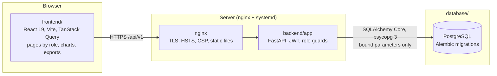

### Backend layers

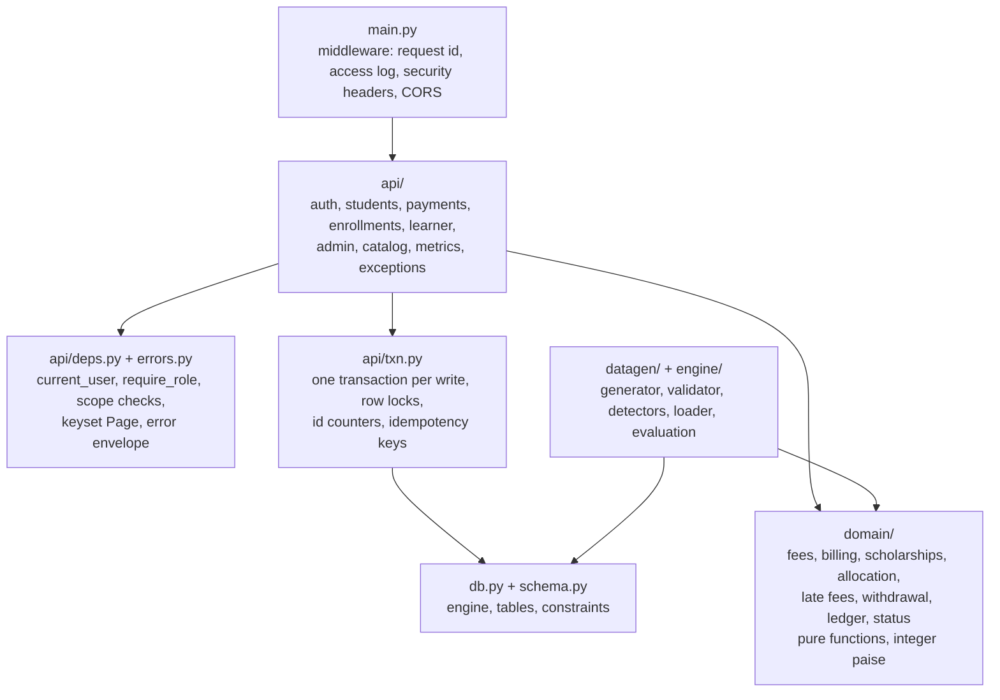

### One write, end to end (a learner pays)

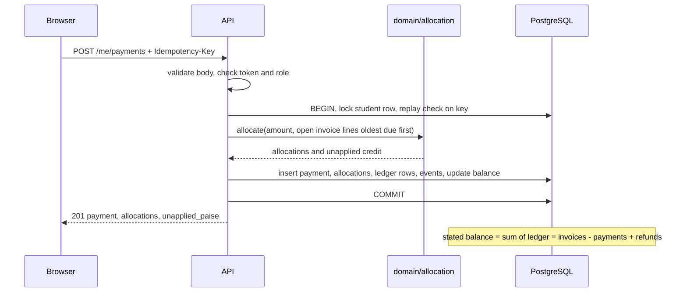

### Who can reach what

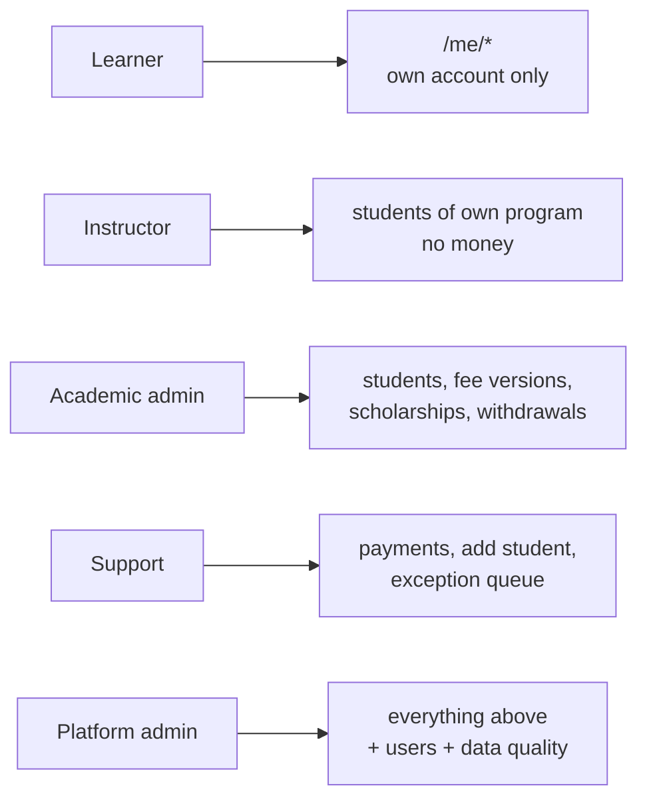

The full role-by-route table is generated from the code: [docs/permissions.md](docs/permissions.md). The rules, entities and API are in [docs/architecture.md](docs/architecture.md).

## Repository map

```
frontend/   React 19 + Vite + TypeScript + Tailwind 4 (pages, design system, unit tests)
backend/    FastAPI app (app/api, app/domain, app/datagen, app/engine), tests/, pyproject.toml, uv.lock
database/   PostgreSQL schema as Alembic migrations, seed SQL for the starter data
data/       generated datasets, manifests and ground truth
reports/    validation, reproducibility and evaluation reports
deploy/     nginx, systemd, deploy script
scripts/    dev.py (cross-platform task runner), scrub_check.py
docs/       architecture, practices, decisions, testing, deploy, data dictionary, ERD, walkthrough
prompts/    prompt history and the statement of AI use
```

## Honest limits

- **Perfect detection is by construction.** The detectors do not read the ground truth, but they recompute the same
  rules the generator used, so precision and recall of 1.0 show the rules are implemented consistently. They do not
  show that the detectors would find unknown faults in real data. Treat the score as a regression test, not evidence of generalisation.
- **Dates are frozen.** Every status and balance is stated as of 2026-09-05 (`AS_OF`); new payments and withdrawals are
  dated that day. There is no scheduler issuing invoices or late fees as time passes.
- **Writes are serialised.** One advisory lock orders id allocation, so write throughput is bounded to one transaction at a
  time. Ample for a back-office tool; database sequences would lift it ([docs/decisions.md](docs/decisions.md)).
- **Login throttling and timing equalisation are deliberately not built yet** (owner decision while testing); a test
  pins their absence so adding them is a conscious change.
- **Currency is INR in paise** by assumption; the brief does not name one.
- The public demo accepts writes by design; all data is synthetic and the loader restores the seeded state.

## How AI was used

AI assistance (Claude) was used for planning, writing code and tests, and documentation, as the brief allows. The
design decisions, the rules, the labelling scheme and the review of every result were mine. Prompt history and a plain
account of what was generated, what I changed and how I checked it are in [prompts/](prompts). I can walk through any file.

## Documents

| | |
|---|---|
| [docs/architecture.md](docs/architecture.md) | the specification: tiers, entities, every business rule, data generation, API, security |
| [docs/practices.md](docs/practices.md) | each engineering practice used, where, why and how far |
| [docs/decisions.md](docs/decisions.md) | the choices that could have gone another way, and the reasons |
| [docs/testing.md](docs/testing.md) | the test strategy and what each group proves |
| [docs/frontend.md](docs/frontend.md) | the design system, motion, loading states, pages by role, exports, error pages, accessibility |
| [SETUP.md](SETUP.md) | install, run, settings, checks and troubleshooting; `run.bat` does it in one step |
| [docs/permissions.md](docs/permissions.md) | the role-by-route permission matrix, generated from the route guards |
| [docs/edge-cases.md](docs/edge-cases.md) | every edge case and negative scenario, what enforces it, the test that proves it |
| [docs/deploy.md](docs/deploy.md) | production setup, deploy, rollback, mail, operations |
| [docs/walkthrough.md](docs/walkthrough.md) | one student, every record, generated from the data |
| [docs/data_dictionary.md](docs/data_dictionary.md), [docs/erd.md](docs/erd.md) | generated from the schema |
| [database/README.md](database/README.md) | the database tier |
