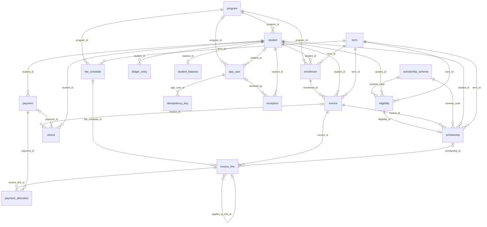

<!-- Generated by `python -m app.cli docs` from backend/app/schema.py. Do not edit by hand. -->
# Entity relationship diagram

Generated from the foreign keys in the schema. `||--o{` reads as one parent to many children; `|o` means the parent is optional.

